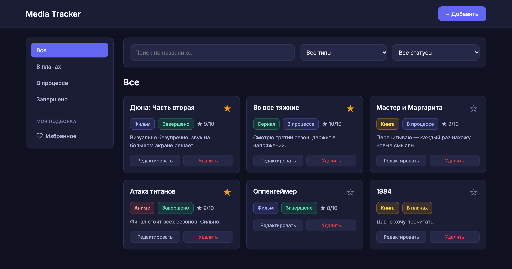
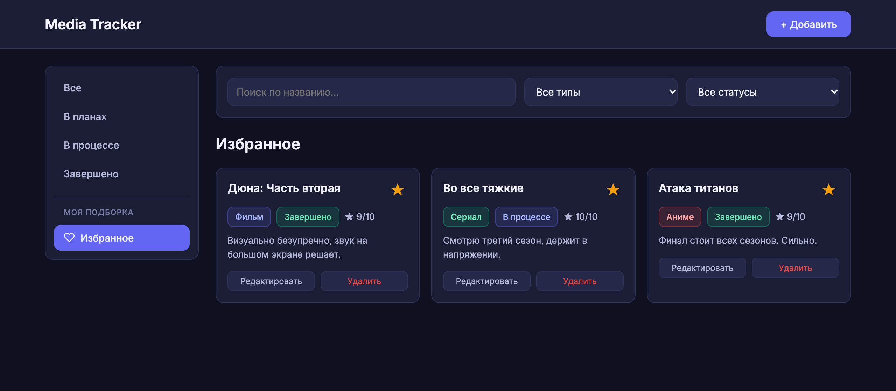
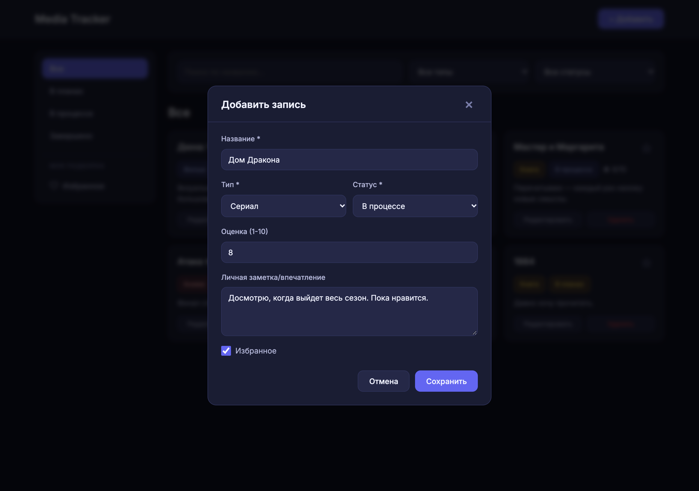
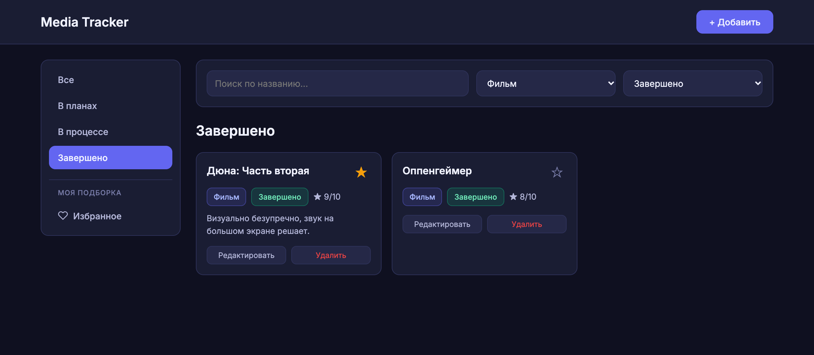
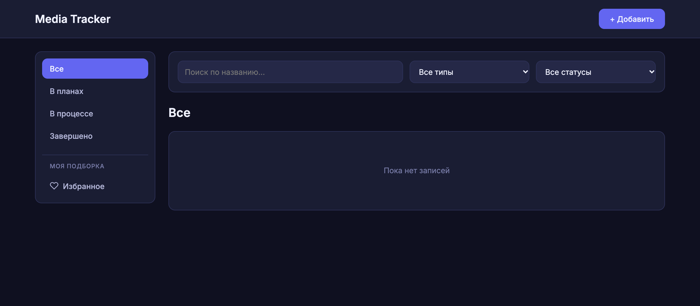

# Media Tracker

Браузерное приложение для ведения личной библиотеки фильмов, сериалов, книг и аниме. Позволяет собирать записи о просмотренном и запланированном контенте в одном месте, отмечать прогресс, ставить оценки, сохранять заметки и добавлять избранное.

Приложение работает полностью в браузере на стороне клиента — без backend, базы данных, авторизации и сборки.



## Возможности

- добавление, редактирование и удаление записей;
- четыре типа контента: фильмы, сериалы, книги и аниме;
- статусы «В планах», «В процессе», «Завершено»;
- оценки от 1 до 10;
- текстовые заметки;
- добавление в избранное;
- поиск по названию;
- фильтры по типу и статусу;
- отдельные разделы для всех записей, статусов и избранного;
- пустые состояния и сброс фильтров;
- адаптивный интерфейс.

## Скриншоты

### Избранное

Отдельный раздел с отмеченными записями. Звёздочку можно переключить прямо на карточке.



### Добавление записи

Модальное окно с полями названия, типа, статуса, оценки, заметки и флага «Избранное».



### Поиск и фильтры

Результат фильтрации по типу («Фильм») и статусу («Завершено»). Статус-фильтр синхронизируется с разделом в меню.



### Мобильный вид

Адаптивная раскладка на небольшой ширине экрана (около 390 px).


### Пустое состояние

Экран при отсутствии записей.



## Технологии

- HTML5
- CSS3
- Vanilla JavaScript (ES6+)
- localStorage
- Google Fonts (Inter)

Приложение работает на стороне браузера: без backend, базы данных, авторизации и сборки.

## Запуск

1. Открыть `index.html` в браузере.

Либо, при необходимости, запустить локальный сервер из корня проекта:

```bash
python3 -m http.server 8000
```

Затем открыть `http://localhost:8000`.

## Хранение данных и ограничения

- Записи хранятся в `localStorage` браузера под ключом `media-tracker-items`.
- Данные не синхронизируются между устройствами и браузерами.
- Резервное копирование, импорт и экспорт не реализованы.
- Очистка данных браузера (кэша или хранилища сайта) может привести к потере записей.
- Постеры, обложки, пагинация и сортировка не реализованы.

## Статус проекта

Клиентское веб-приложение для личного учёта медиаконтента. Не является коммерческим продуктом.

> Скриншоты сделаны с демонстрационными записями, которые используются только для иллюстрации интерфейса.
